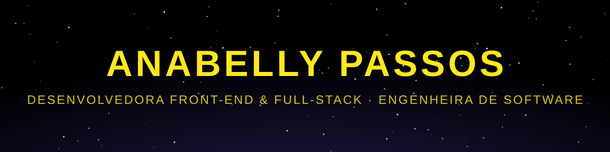

  

  

---

## 🌌 Episódio I — Quem sou eu

Sou **Anabelly Passos**, Engenheira de Software e desenvolvedora **Front-end & Full-Stack**, com cerca de **3 anos de missões remotas** para empresas do Brasil e do exterior (Espanha e Noruega), nos setores de **saúde, jurídico e financeiro**.

Meu sabre de luz principal é **React + TypeScript**, mas também já enfrentei batalhas com **Angular**, **Vue.js**, **Node.js** e **Flutter**. Atuo da prototipação no Figma até o deploy, sempre de olho na experiência do usuário.

## ⚔️ Episódio II — Meu arsenal

  

| Setor da galáxia | Tecnologias |
|---|---|
| **Front-end** | React · TypeScript · Angular · Vue.js · Tailwind CSS |
| **Estado e dados** | TanStack Query · Zustand · React Hook Form · Zod |
| **Back-end** | Node.js · Express · Prisma · PostgreSQL · Supabase · Firebase |
| **Mobile** | Flutter · React Native |
| **Ferramentas** | Git · GitHub · Docker · Vercel · Figma · Jira |

## 🚀 Episódio III — Missões em destaque

| Missão | O que é | Ver em ação |
|---|---|---|
| [**Pulse Admin**](https://github.com/anabellypassos/Pulse-Admin) | Dashboard full-stack com dados em tempo real: React, TypeScript, TanStack Query, Zod e Supabase | [Demo](https://pulse-admin-whrw.vercel.app/) |
| [**Form Builder**](https://github.com/anabellypassos/form-builder-challenge) | Desafio full stack: back-end em Go (Gin, GORM) e front-end em React + TypeScript | — |
| [**DocMind AI**](https://github.com/anabellypassos/office-magic) | Editor de documentos com IA (Gemini), calendário e tarefas | [Demo](https://office-magic.vercel.app) |
| [**Kanban**](https://github.com/anabellypassos/task-manager-kanban) | Quadro Kanban em JavaScript puro, com arrastar e soltar e versão PT/EN | [Demo](https://task-manager-kanban-gules.vercel.app) |

## 🛰️ Episódio IV — Uma nova esperança

Estou em busca da minha próxima missão como **Desenvolvedora Front-end ou Full-Stack** (React, Angular, TypeScript, Node.js), em trabalho **remoto**, com **disponibilidade imediata**.

🧘 **Treinamento Jedi em andamento:** testes automatizados (Vitest, Testing Library, Playwright) e Next.js.

## 📡 Comunicação com a base

  
  
  
  

<b>✨ Que a Força esteja com você — e com o seu código. ✨</b>

